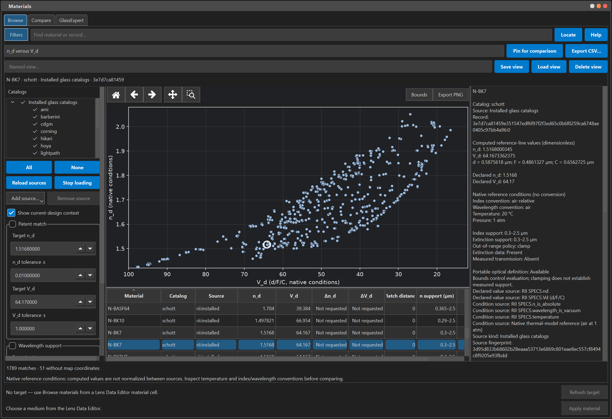
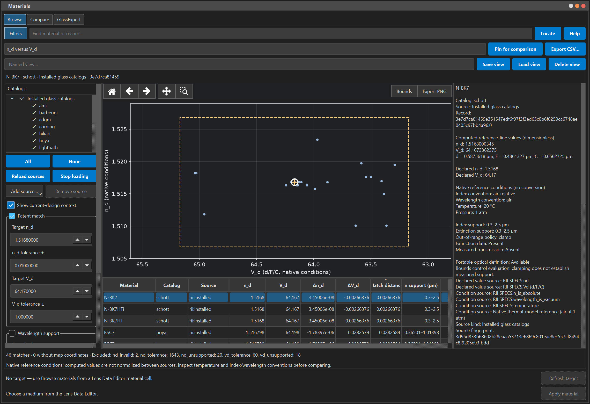
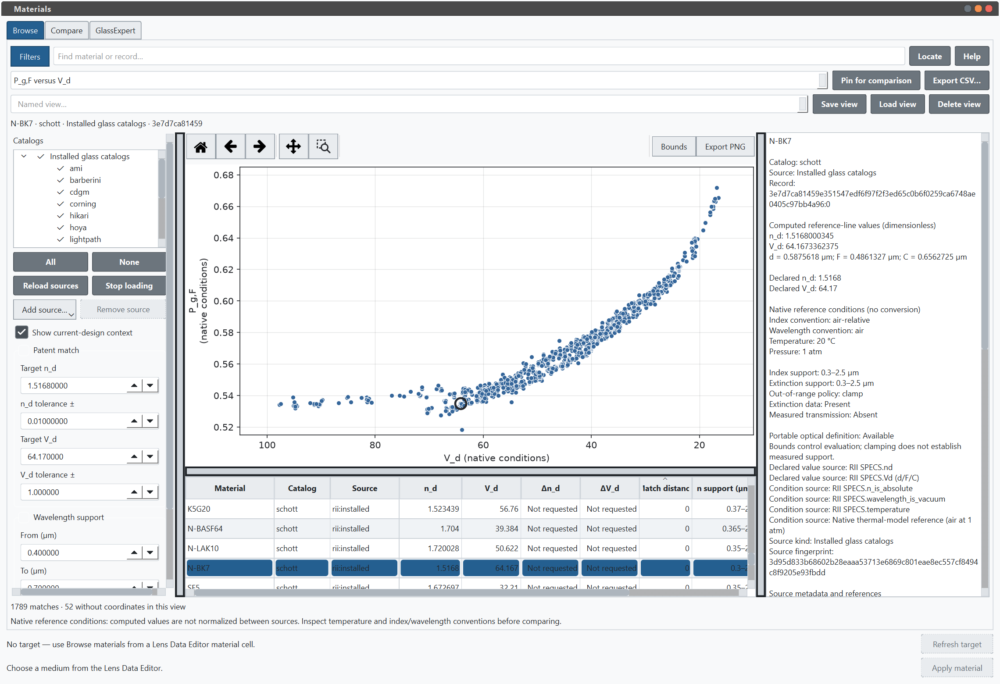
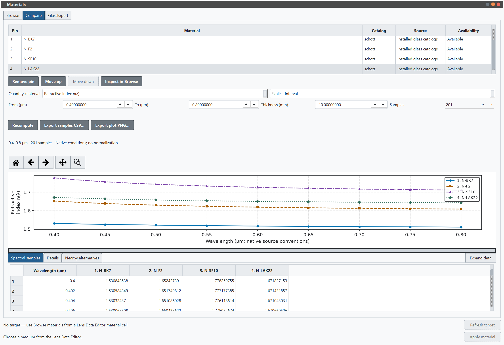
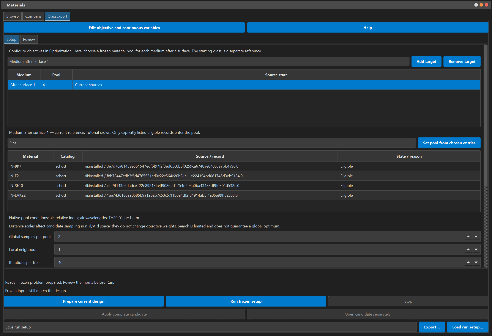
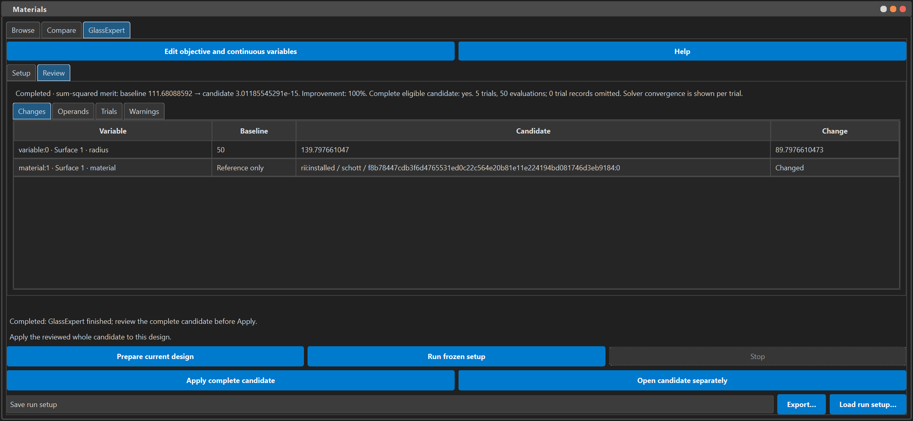
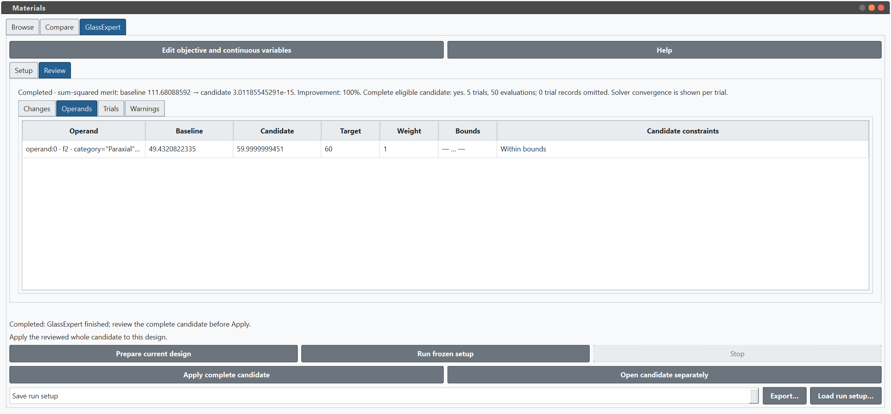

# Glassmap UI preview

Screenshots captured on **15 October 2026** for the discussion in
[issue #223: Interactive Glass Map](https://github.com/optiland/optiland/issues/223).
They show the working implementation at
[`99b56767`](https://github.com/BrunoChevalier/optiland/tree/99b56767d58d34648936d19d11fe5bca238f98d4),
available on the
[`codex/glassmap-gui-preview-20261015` branch](https://github.com/BrunoChevalier/optiland/tree/codex/glassmap-gui-preview-20261015).

The Materials workspace uses Optiland's existing PySide6 Widgets and Matplotlib
stack. Material discovery, optical properties and queries are independent of the
renderer. The preview includes browsing, comparison, explicit material application
and a later GlassExpert integration. Its integration base still contains unmerged
GUI/import prerequisites; the proposed upstream work will need to be split into
small contributions, starting with the data layer.

All seven images below are direct captures of the actual desktop application,
using installed catalog data and the bundled tutorial singlet. The GlassExpert
results come from a real worker run. No client designs, mockups or composited
results are shown. Click an image to inspect its full resolution.

## 1. Catalog browsing — dark theme

The Browse tab links a catalog/filter pane, the conventional **n_d versus V_d**
map, a sortable results table and an inspector. The Abbe axis descends from left
to right. Selecting a point or table row identifies an exact source/catalog/record;
equal names remain separate entries.

This view contains **1,789 records**, including **51 without usable map
coordinates** that remain accessible in the table. N-BK7 is selected, and the
inspector shows computed and declared values, reference conditions, spectral
support and provenance. Browsing alone does not modify a lens. Pan, wheel zoom,
rectangle zoom, history and numeric bounds use the shared plot controls.

## 2. Patent-style material matching

Independent tolerances around **n_d = 1.5168 ± 0.01** and
**V_d = 64.17 ± 1.0** return **46 records**. Both bounds must pass. The dashed
rectangle shows the accepted region; the zoomed map makes nearby candidates
visible, while the table reports signed index/Abbe differences and match distance.

The selected glass keeps its exact source identity. Matching does not silently
widen tolerances, replace missing values with zero or apply a candidate to the
design.

## 3. Partial-dispersion map — light theme

The same catalog data can be explored in alternative optical-property views.
Here, **P_g,F = (n_g − n_F) / (n_F − n_C)** is plotted against V_d, with the
N-BK7 selection retained. **1,737 records** have coordinates in this view;
the other **52** remain inspectable in the table.

Axis labels and the inspector identify the native reference conditions. Values
are not silently normalized between sources. The light theme also demonstrates
that plot backgrounds, labels and navigation icons follow the application theme.

## 4. Spectral comparison

Up to four exact records can be pinned independently of the current Browse
selection. This example compares **N-BK7, N-F2, N-SF10 and N-LAK22** over
**0.4–0.8 µm**, using **201 wavelength samples**.

The plot and sample table use the same calculated values. Numbered legends,
different markers and line styles distinguish the curves without relying only
on color. Controls support interval selection, recomputation and CSV/PNG export.
Internal transmission is another supported comparison quantity when the material
data permits it; this screenshot shows refractive index.

## 5. GlassExpert setup

GlassExpert is a separate extension of the browsing workflow. The example uses
the openly editable [tutorial singlet](samples/glassmap/singlet.json), with the
medium after surface 1 as its explicit target. The four inspected comparison
pins become a **frozen candidate pool**. Later Browse selections do not silently
change that pool, and the starting material remains a separate reference.

The continuous variable is the first surface radius, bounded between **20 and
150 mm**, with a **60 mm effective focal length** target. The displayed settings
use two global samples, one local neighbour and at most 40 iterations per trial.
This small teaching example illustrates the interaction; it does not establish
the optical quality of a production lens.

## 6. GlassExpert result review

The real run completed **five trials and 50 evaluations**. Its sum-squared merit
changed from approximately **111.681** to **3.01 × 10⁻¹⁵** for the focal-length
objective. Review exposes both the continuous radius change and the exact
material assignment, rather than presenting only a glass substitution.

Preparing and running the search left the live tutorial lens unchanged.
**Apply complete candidate** explicitly accepts the reviewed result through the
document/history workflow; **Open candidate separately** provides another way
to inspect it. Completion, solver convergence and eligibility for acceptance are
reported separately.

## 7. Per-operand result review — light theme

The same completed result can be inspected per operand. This view shows the
baseline effective focal length of approximately **49.432 mm**, the candidate
value of approximately **60 mm**, its target and weight, and the constraint state.
The other Review tabs provide changes, retained trials and warnings.

This makes the numerical result reviewable before acceptance. A focal-length-only
objective does not by itself validate aberrations, manufacturing constraints or
overall lens suitability.

## Further documentation

- [Materials user guide](gui_materials.rst)
- [Materials tutorial](gui_materials_tutorial.rst)
- [GlassExpert tutorial](gui_glass_expert_tutorial.rst)
- [Material discovery and query architecture](developers_guide/material_discovery.rst)

The screenshots were captured on Windows at 150% display scaling with isolated
application settings. Existing widgets and services were driven programmatically;
the images were not retouched. This gallery documents the preview revision and
does not replace the implementation's tests or a manual accessibility review.
