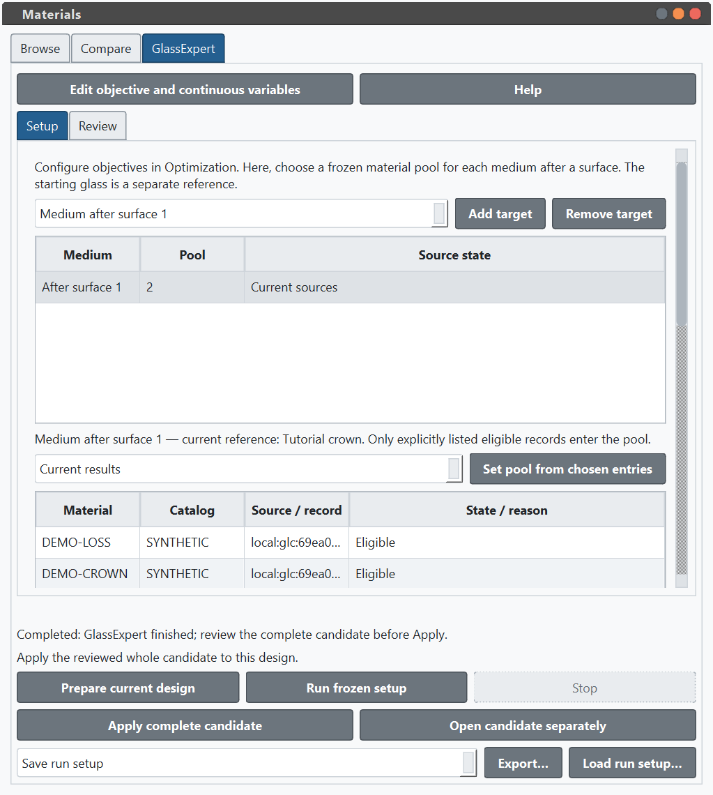
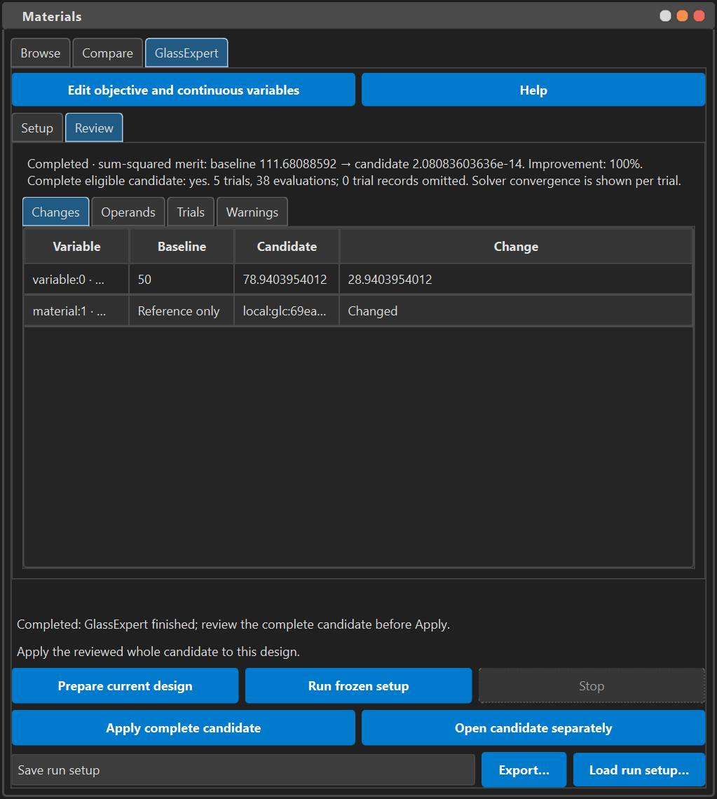

.. _gui-glass-expert-tutorial:

Optimize exact material pools in the desktop GUI
================================================

GlassExpert searches discrete material assignments while optimizing the continuous
variables in the same objective. This tutorial uses the native **Materials**
workspace. Install and launch the desktop application as described in
:doc:`gui_quickstart`; the GUI is independent of the documentation site's browser
notebooks. Use the development build documented here, because earlier releases
may not contain these controls.

The worked example uses synthetic, openly editable data. It is a lesson in
selection, optimization and review, not a validated production lens. Before
starting, download :download:`singlet.json <samples/glassmap/singlet.json>` and
:download:`tutorial.glc <samples/glassmap/tutorial.glc>` into one local directory.
The first is a self-contained native lens. The second contains two synthetic
GLC records, ``DEMO-CROWN`` and ``DEMO-LOSS``. Their provenance and deliberate
missing-data cases are described in :doc:`gui_materials_tutorial`.

Prepare the lens and objective
------------------------------

1. Choose **File → Open System** and open ``singlet.json``. The object, two lens
   surfaces and image plane appear in the Lens Data Editor. Keep this source
   file as a reusable starting point; later Save As can write a new lens.
2. Open **Materials** from the sidebar. In Browse, open **Filters** if collapsed,
   then choose **Add source… → OSLO GLC file…**, select ``tutorial.glc``, and wait
   for its accepted source to appear.
3. Select only that catalog and clear the text, patent-match and wavelength
   restrictions. The two tutorial records should be visible. Inspect each one's
   qualified identity and support before including it in an optimization pool.
4. Open the existing **Optimization** editor. In **Variables**, choose **Add
   Variable** and add a **Radius** variable for surface ``1``, with minimum
   ``20`` and maximum ``150``. These are physical radius limits in millimetres.
5. In **Operands**, choose **Add Operand** and add the effective-focal-length
   operand ``f2``, target ``60`` and weight ``1``. Use the primary wavelength.
   This deliberately small objective makes the result easy to interpret; it
   does not constrain spot size, distortion or manufacturing suitability.

Keep ordinary continuous variables in the existing editor. Material targets and
their exact discrete pools belong to GlassExpert's Setup page. The two editors
do not define competing copies of the merit function.

Freeze a material pool
----------------------

1. Open **Materials → GlassExpert → Setup**. Add the medium after surface ``1``
   as a target. Check the row label carefully: the material applies to the space
   following that surface, which is the interior of this singlet.
2. With that target selected, choose **Current results** in the pool-source
   control, then **Set pool from chosen entries**. The Browse result set contains
   exactly the two tutorial GLC records. Read the resulting qualified pool table
   and confirm the count is ``2``.
3. Inspect the separately listed baseline reference. The sample lens's original
   owned material is a reference for reporting; it is not silently inserted into
   the allowed candidate pool.

Setting a pool is an explicit snapshot. Later searches, catalog checkboxes and
comparison pins do not silently change it. You can also form a pool from an
inspected selection or from the ordered comparison pins. A single candidate
makes a target fixed, while every nontrivial pool remains part of the search.
At least one target needs more than one candidate. An empty pool or an
unsupported target prevents preparation with an explanation.

   The pool remains explicit while Setup scrolls. Preparation and acceptance
   controls remain available below the page.

Choose reproducible settings
----------------------------

Use the following values in Setup. Commit each numeric edit with ``Enter`` and
use the decimal separator for your desktop locale.

.. list-table:: Tutorial settings
   :header-rows: 1
   :widths: 50 20 30

   * - Setting
     - Value
     - Meaning
   * - Global samples
     - ``2``
     - Two starting representatives from each nontrivial pool.
   * - Local neighbours
     - ``1``
     - Nearby material assignments considered during refinement.
   * - Maximum iterations per trial
     - ``40``
     - Bound on each continuous optimization trial.
   * - Tolerance
     - ``1e-8``
     - The continuous solver's convergence tolerance.
   * - Seed
     - ``1234``
     - Repeatable starting selection for this frozen input.
   * - ``n_d`` scale
     - ``0.05``
     - Scale for pool geometry along refractive index.
   * - ``V_d`` scale
     - ``20``
     - Scale for pool geometry along Abbe number.

The distance scales govern which material representatives are near each other.
They are independent of operand weights and do not express optical merit. The
implementation uses seeded farthest-point representatives and exact candidate
identities. Equal names or equal glass-map coordinates do not merge records.
Global sample count must fit every nontrivial pool; it cannot exceed this
tutorial's two-record pool.

Prepare, run and review
-----------------------

1. Choose **Prepare current design**. The background worker freezes the lens,
   objective, continuous bounds, target rows, exact owned material definitions,
   source generations and numerical backend. Read its baseline merit, resolved
   definitions and warnings before running.
2. Choose **Run frozen setup**. Preparation and optimization leave the live lens unchanged.
   Progress reports the current phase and evaluations. **Stop** requests
   cancellation; wait for the stopping state to finish before starting another
   run.
3. Open **Review**. Compare baseline and candidate merit, continuous physical
   values, exact material assignments, per-operand values, bounds indicators,
   trials and warnings. The merit is a sum of squared weighted residuals; a
   smaller value is better for this objective.
4. Confirm that the candidate contains both the radius change and the complete
   material assignment. Solver convergence, improvement and eligibility for
   acceptance are separate facts. A valid candidate can remain explicitly
   acceptable when it did not improve the merit or a local trial did not
   converge. A failed, cancelled or incomplete candidate cannot be applied.

GlassExpert checks configured wavelengths against known material support before
running. Unknown support and missing extinction retain explicit warnings; they
do not become measured transmission data. The result still needs optical and
engineering review for the design's intended use. A focal-length-only objective
does not certify image quality or physical manufacturability.

In the verified NumPy walkthrough, the starting merit was about ``111.68088592``
and the candidate merit was about ``2.08e-14`` after five recorded trials and
38 merit evaluations. Tiny residuals and evaluation counts can vary with solver
and numerical-library versions; inspect the actual report. These numbers describe
this single focal-length objective, not the quality of the complete lens.

   Review uses the worker's frozen values. Qualified cells retain their complete
   values in tooltips and can be copied; resize or scroll columns as needed.

Apply the complete result and undo it
-------------------------------------

Choose **Apply complete candidate** only after reviewing the entire prescription.
This accepts the continuous and material changes together as one document
transaction. It marks the lens modified without changing its file path. **Edit →
Undo** restores the original lens in one step, and **Edit → Redo** restores the
accepted candidate. Both history actions can use the shared background worker.
Use **File → Save System As** to save a separate native lens when satisfied.

To analyze the candidate before accepting it, choose **Open candidate separately**.
The worker validates the portable native prescription and opens an untitled,
modified lens in a separate application window. Use its usual analysis tools and
save it explicitly if desired. The original lens and its history are unchanged.

The application checks freshness again when Apply is pressed. Editing the lens
or objective, changing the backend, reloading a source, replacing a target or
starting another relevant operation can make the retained run stale. Read the
reason and prepare the intended current design again. Inspecting a result,
switching tabs, completing a run and closing the dock never apply it.

Save a setup and replay it independently
----------------------------------------

Choose an output type, then **Export…** to select its destination. **Save run
setup** writes the frozen native baseline, exact embedded candidate
definitions, objective, bounds, settings, seed and provenance into a bounded
manifest. Supported terminal results can be included for inspection. **Export
script** creates a public-core Python replay without running it; **Export native
candidate** writes a supported complete native prescription. These exports leave
the current lens path, clean/dirty state and Undo history unchanged.

Loading a run setup is detached inspection and replay. It does not load a lens
into the editor or restore an old run's right to apply. Missing or changed
catalogs remain explicit; the embedded definitions are not replaced by same-name
records. Use **Prepare current design** to acquire new acceptance authority from
the current lens and available exact source generations. If you intend to edit
an exported lens, open it explicitly through the normal File menu.

Run an exported script with the documented Optiland build in a fresh Python
process. It uses the recorded backend and frozen inputs, so install that backend
when required. See :doc:`typed_glass_expert` for the public typed-pool API and the
self-contained Python example. The earlier :doc:`examples/Tutorial_3e_Glass_Expert_Categorical_Optimization`
retains the supported catalog-name workflow.

The same saved manifest can be replayed directly through the public core API:

.. code-block:: python

   from pathlib import Path
   from optiland.optimization.glass_expert_replay import (
       decode_glass_expert_manifest,
       replay_glass_expert,
   )

   inputs = decode_glass_expert_manifest(
       Path("glass-expert-setup.json").read_bytes()
   )
   replay = replay_glass_expert(inputs)
   candidate = replay.report.candidate
   if candidate is not None and replay.report.candidate_eligible:
       print(replay.report.baseline.merit, candidate.merit)
       candidate_optic = replay.optic
   else:
       print("No complete eligible candidate; inspect the report.")

This explicitly runs optimization on a restored baseline. It does not touch an
open desktop document or write a lens file. See
:doc:`api/optimization/optimization.glass_expert_replay` for validation, portable
component restrictions and cancellation callbacks.

Recover from common states
--------------------------

Try a deliberate stale-result check on a disposable copy of the sample. Complete
a run but do not apply it. In the Optimization editor, change the ``f2`` target
from ``60`` to ``61``. Return to GlassExpert: the retained report still describes
the frozen ``60`` objective, and **Apply complete candidate** is unavailable
with a changed-definitions reason. The lens remains unchanged. Set the intended
target, choose **Prepare current design**, and run again before considering
acceptance. Alternatively, press **Stop** during a run and wait for cancellation;
no partial candidate is applied.

* **Preparation unavailable:** read the target/pool reason, use a supported
  medium, and provide at least one nontrivial exact pool plus a valid objective.
* **Too many global samples:** lower the count to fit the smallest nontrivial
  pool. Do not enlarge a pool with unreviewed materials merely to satisfy it.
* **A source changed:** inspect the replacement source and explicitly rebuild
  the intended pool before preparing again. No name-based substitute is chosen.
* **Stopped or failed:** retain the diagnostics, fix the cause and prepare/run
  again. Cancellation does not commit a partial prescription.
* **Apply is stale or busy:** finish the conflicting operation or prepare the
  current design again. A saved setup is always detached when loaded.
* **Native or script export is unavailable:** inspect the reported unsupported
  native component or descriptor. The tool does not fabricate a portable result.

The full workspace controls and material conventions are in :doc:`gui_materials`.

Scientific scripts and the interactive Console
----------------------------------------------

The exported replay script is a public Python program for a fresh process. In
the desktop Scripts workspace, **Scientific Run** also executes on an independent
optic and offers its own **Apply Script Result** action. The existing **Console**
retains live ``connector``/``iface`` GUI access; executing code there can directly
change the open document. Console execution is not the frozen GlassExpert
workflow and does not grant an old result fresh acceptance authority.
