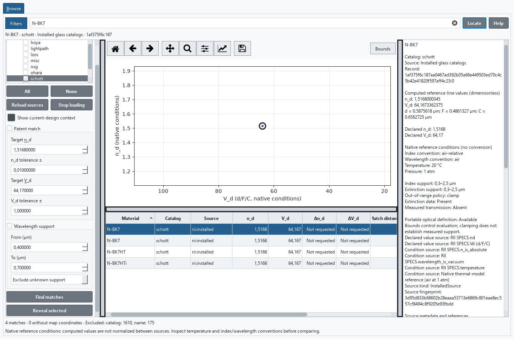
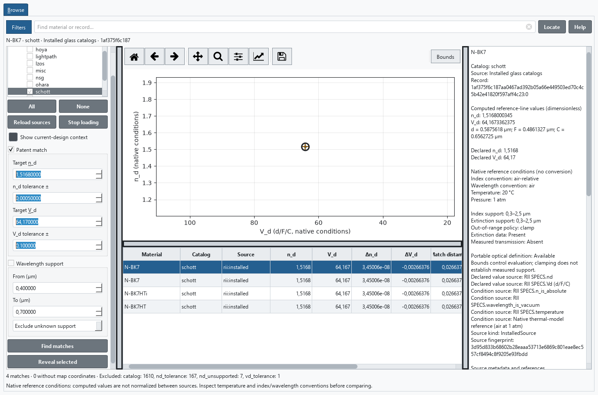
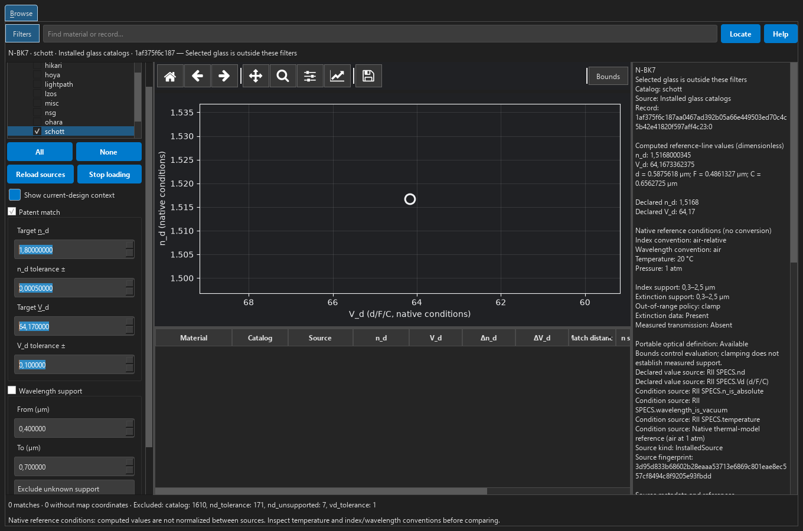
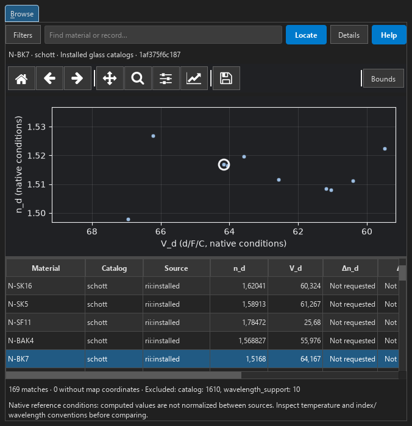
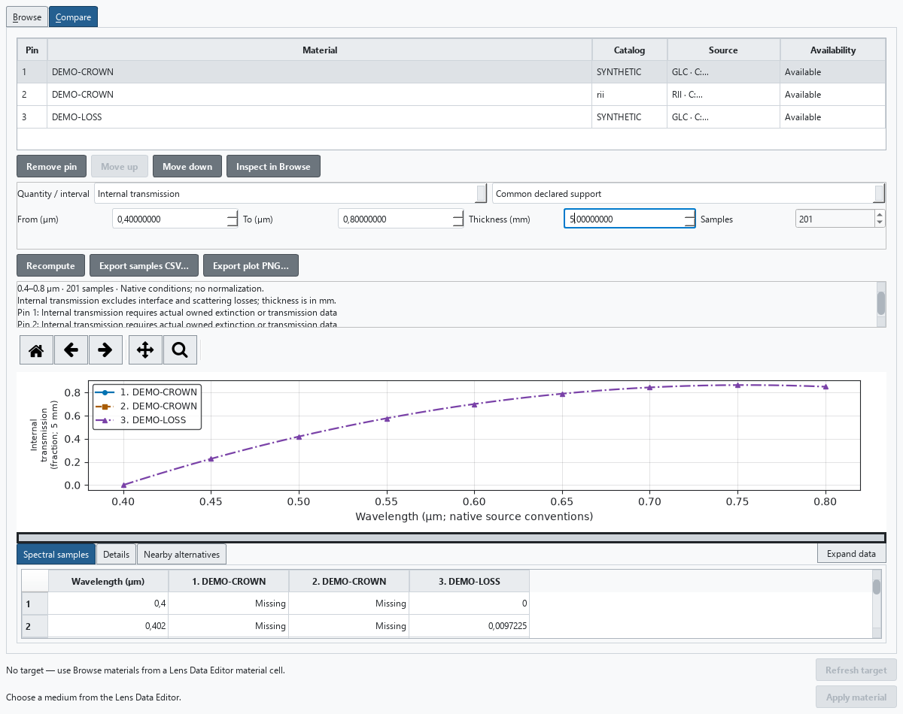
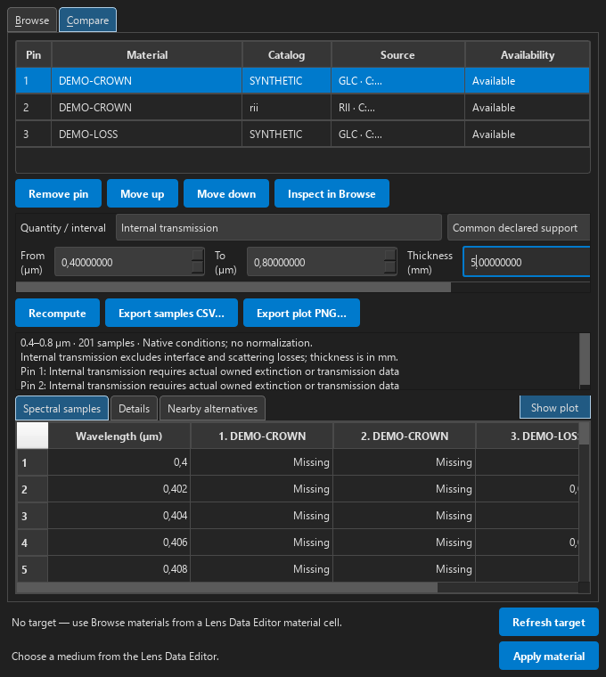
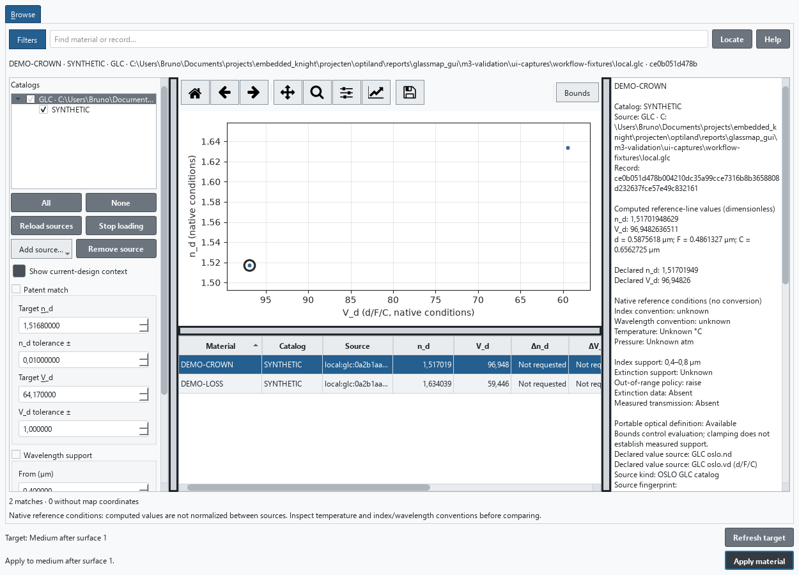
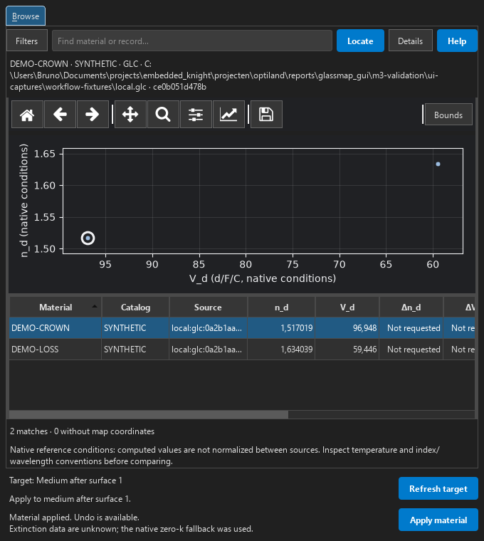

.. _gui-materials-tutorial:

Find, inspect and apply a glass in the desktop GUI
==================================================

This walkthrough uses the **Materials** workspace in the development version
documented here. Use a build containing that workspace; older installed releases
may not have it. Follow :doc:`gui_quickstart` to install the GUI dependencies and
launch Optiland. The desktop GUI runs locally, independently of the documentation
site's browser notebooks.

You will identify a source-qualified glass, reproduce a patent-style search,
recover an empty result, distinguish same-name local records, and apply a glass
to a self-contained sample lens with Undo/Redo and native persistence. The catalog
search uses installed data and needs no supplier account or live download.
Selecting a row or map point only inspects the material.

Find an exact installed record
------------------------------

1. Launch the GUI and open **Materials** in the sidebar. You can do this before
   opening a lens. Wait for the installed source to finish loading.
2. In **Filters**, choose **None**, then expand the installed source and check
   only its **schott** catalog. This is an exact catalog selection. The same
   catalog label under a different source is a different choice.
3. Press ``Ctrl+F`` and enter ``N-BK7``. Wait for the result count to settle.
   The search can also find names such as ``N-BK7HT`` and ``N-BK7HTi``.
4. Select the table row whose material name is exactly ``N-BK7`` and whose source
   is ``rii:installed``. The recorded source contains two separate N-BK7
   references. Use the inspector's full **Record** identifier to distinguish
   them. The reference beginning ``1af375f6c187aa04`` is the first example used
   here; ``3e7d7ca81459e351`` is the other. Both have the same coordinates in this
   catalog revision.
5. Read computed ``n_d`` and ``V_d``, the source's declared values, its native
   conditions and separate n/k wavelength support. Do not treat an unknown
   condition or missing measurement as zero.
6. With the table focused, press ``Ctrl+C`` to copy the selected row's qualified
   identity and values. Sorting a header preserves the identity of the selected
   record. The arrow keys select another row without requiring a map click.

The default plot places ``n_d`` on the vertical axis and ``V_d`` on the
horizontal axis, descending from left to right. N-BK7 is near ``(64.16734,
1.5168000)``. If you click its coincident points, choose the exact source/catalog/
record from the native menu. Table selection is an equivalent keyboard route.
An outlined point is selected; current-design diamonds and transient hover halos
mean something different. These shapes remain useful without interpreting color.

   An exact table selection links the map and property inspector. Scroll the
   table horizontally to reach additional columns; copying includes its full
   qualified identity.

Reproduce a patent-style match
------------------------------

1. Clear the search with ``Ctrl+F``, then ``Backspace``.
2. Enable **Patent match** and enter the following values. Use the decimal
   separator expected by your operating system's regional settings.
   Press ``Enter`` to commit each numeric edit.

   .. list-table:: Independent matching criteria
      :header-rows: 1
      :widths: 40 30 30

      * - Coordinate
        - Target
        - Tolerance
      * - ``n_d``
        - 1.5168
        - 0.0005
      * - ``V_d``
        - 64.17
        - 0.1

3. Leave **Wavelength support** disabled for this first lookup and select
   **Find matches**. The rectangle depicts the two independent tolerances.
4. Inspect ``Δn_d``, ``ΔV_d`` and **Match distance**. The recorded installed
   source returns four rows: the two N-BK7 references, N-BK7HT and N-BK7HTi.
   Each has approximately ``n_d = 1.5168000345``, ``V_d = 64.16733624``,
   ``Δn_d = +3.45 × 10⁻⁸``, ``ΔV_d = −0.00266376`` and distance ``0.0266377``.
   The two N-BK7 references remain separate even when all numerical values tie.

Distance is the Euclidean length after dividing each delta by its respective
tolerance. It ranks passing rows; both tolerances must independently pass. This
does not establish that candidates have interchangeable transmission, thermal
behavior or performance in a lens. These are native-condition coordinates, not
values normalized between suppliers.

The recorded installed-source fingerprint is
``3d95d833b68602b28eaaa53713e6869c801eae8ec557cf8494c8f9205e93fbdd``.
If a later catalog revision changes the rows or values, inspect its fingerprint
and references instead of forcing a match to this list. The d/F/C wavelengths
and missing-data conventions are explained in :doc:`gui_materials`.

   The target and its two tolerances define the passing set. Equal numerical
   coordinates still retain separate exact records.

Recover an empty result and a hidden selection
----------------------------------------------

1. Keep one N-BK7 row selected. Change the ``n_d`` target to ``1.8``, retaining
   the same tolerances and ``V_d`` target, then choose **Find matches**. In the
   recorded SCHOTT source this produces no matches. The tool does not widen
   your criteria.
2. The selection summary now identifies a selected record outside the filters.
   Select **Locate**: the map centers on that selected material at the current
   zoom, while the result remains empty. The selected outline is not another
   matching result.
3. Select **Reveal selected** to explicitly clear search/patent/wavelength
   restrictions and enable the selected record's catalog. This is a deliberate
   filter change, distinct from moving the map.
4. Enable **Wavelength support**, request ``0.4`` through ``0.7`` µm and choose
   whether to include unknown support. For a known interval, the whole requested
   range must be supported.
5. Try a minimum wavelength larger than the maximum, then choose **Find
   matches**. Read the validation message: the previous rows remain retained
   information, not the answer to the invalid request. Correct the interval to
   ``0.4``–``0.7`` and submit again.

   Locate preserves a hidden selection and the zoom without changing the query.

Navigate without losing the selected material
---------------------------------------------

Use the wheel to zoom around the pointer, the toolbar to pan or rectangle-zoom,
and Back/Forward to revisit completed views. **Bounds** accepts ordered numeric
axis limits; invalid values leave the view unchanged. With the plot focused,
arrow keys pan, ``+``/``-`` zoom and ``Home`` fits the visible results and
current-design context. ``Escape`` closes an overlap chooser or exits navigation
mode without clearing the selection.

Press ``F6`` to move between the main regions and use ``Tab``/``Shift+Tab``
within them. In a narrow dock, **Filters** opens the filter controls and
**Details** switches to the inspector. The same instructions work in either
application theme.

   Compact docks retain the map, table and selected identity while filter and
   inspector regions remain available through their buttons.

Keep a reproducible starting lens
---------------------------------

Download :download:`the tutorial singlet <samples/glassmap/singlet.json>` and
open it with **File → Open**. It contains four surfaces, a 10 mm entrance pupil,
fields at 0° and 3°, and the F/d/C wavelengths. The named material **Tutorial
crown** follows surface 1, the front surface. Air follows surface 2, the back
surface. See the medium-after-surface rule in :doc:`conventions`.

The sample owns a synthetic formula valid from 0.4 to 0.8 µm, with bounds policy
``raise``. It needs no external catalog to reopen. Its computed coordinates are
approximately ``n_d = 1.514483146`` and ``V_d = 53.88317042``. It has no measured
extinction or transmission data. **Show current-design context** adds its
diamond to the map; the context does not increase the catalog match count.

This teaching glass is not a manufactured product. The sample can be regenerated
with :download:`make_singlet.py <samples/glassmap/make_singlet.py>` in an
environment containing the documented Optiland version. The
:download:`sample notes <samples/glassmap/README.md>` describe its exact formula
and provenance. Save edited lenses under a new filename to retain a clean
starting point.

Load two deliberately different, same-name records
--------------------------------------------------

1. Download :download:`DEMO-CROWN.yml <samples/glassmap/rii/DEMO-CROWN.yml>` into
   an otherwise empty folder named ``rii``. Download
   :download:`tutorial.glc <samples/glassmap/tutorial.glc>` beside that folder.
   Keep the ``.yml`` and ``.glc`` filename extensions.
2. In **Materials → Filters**, choose **Add source… → RII directory…** and
   select the ``rii`` folder. Wait for loading to finish. Repeat with
   **Add source… → OSLO GLC file…**, selecting ``tutorial.glc``.
3. Turn off **Patent match** and **Wavelength support**, choose **None**, then
   check the catalogs under these two local sources. Press ``Ctrl+F`` and
   search for ``DEMO-CROWN``. Choose **Find matches** if needed.
4. There are two same-name records. Inspect each and compare the source path,
   source kind and full record identifier. They have different formulas and
   coordinates:

   .. list-table:: Synthetic local records at the d/F/C reference lines
      :header-rows: 1
      :widths: 45 25 30

      * - Source
        - Computed n_d
        - Computed V_d
      * - Local RII directory
        - 1.557932583
        - 14.60843601
      * - OSLO GLC catalog
        - 1.517019486
        - 96.94826365

The RII example explicitly declares air-relative index, air wavelengths and
20 °C. The GLC example does not declare those conventions; its rounded summary
coordinates are separate declared values. Both use a 0.4–0.8 µm index interval
and have no supplied extinction data. Neither represents a manufactured glass.

The GLC source also contains ``DEMO-LOSS``. Its synthetic internal-transmission
data include a supplied zero at 0.4 µm for a 5 mm thickness. That zero is real
input data, whereas unknown extinction in ``DEMO-CROWN`` is missing input data.
These quoted samples are for a 5 mm thickness; transmission comparisons must
use the same wavelength and thickness.

Compare the two references and inspect transmission
---------------------------------------------------

1. Select the local RII ``DEMO-CROWN`` row and click **Pin for comparison**.
   Select the GLC ``DEMO-CROWN`` row and pin it too. Clear the name search,
   select GLC ``DEMO-LOSS``, and pin that record. All three identities remain
   separate even when display names match.
2. Change the Browse map to the P_g,F partial-dispersion view. The axes now
   describe (n_g − n_F)/(n_F − n_C) versus V_d. The same selected identity stays
   selected. Return to n_d/V_d to see the original coordinates again.
3. Open **Compare** and choose **Refractive index n(λ)** with **Common declared
   support**. The synthetic records share 0.4–0.8 µm support. In **Spectral
   samples**, inspect the 0.6 µm row: RII ``DEMO-CROWN`` gives 1.555555556 and
   GLC ``DEMO-CROWN`` gives 1.516666667. The curves and table show the same values.
4. Select **Internal transmission**, enter **5 mm** thickness, and wait for the
   fresh result. ``DEMO-LOSS`` gives 0 at 0.4 µm, 0.7 at 0.6 µm and 0.85 at
   0.8 µm. Both ``DEMO-CROWN`` pins show missing data, including an explanation;
   neither becomes a measured 100% transmission curve.
5. Change thickness to **10 mm**. At 0.6 µm, ``DEMO-LOSS`` becomes 0.49, following
   the native thickness scaling. Restore 5 mm. Select **Explicit interval** and
   enter 0.35–0.85 µm to observe unsupported samples outside the known range.
   Return to **Common declared support** afterward.
6. Use the pin table's **Move up** or **Move down** to reorder the curves and
   numbered columns. **Details** describes the selected pin's native formula
   and conditions. In **Nearby alternatives**, keep the visible positive scales
   and click **Find nearby alternatives**; inspect a result only through
   **Inspect alternative in Browse**. Distance alone does not establish a useful
   replacement in this lens.

   Supplied zero transmission is a numeric result. Missing extinction remains
   unavailable, with the same status and reason in the plot and sample table.

   In a compact dock, choose **Expand data** to give the numeric table more
   space. Scroll horizontally to reach every pin and vertically to inspect all
   samples. **Show plot** restores the plot without changing the comparison.

Keep a named view and export your evidence
------------------------------------------

1. Return to **Browse**, enter ``Tutorial shortlist`` in **Named view**, and
   click **Save view**. Change the map and search, then select that name and
   click **Load view**. The map, filters, exact catalogs and ordered pins return.
   Recompute the intended quantity and thickness in Compare when needed.
2. In Browse, click **Export CSV**, choose ``tutorial-map.csv`` and wait for
   completion. The file includes the displayed sort order and full exact keys.
   Export the visible map with its toolbar's **Export PNG**.
3. In Compare, compute **Internal transmission** at **5 mm** over common support.
   Click **Export samples CSV…** and save ``tutorial-transmission.csv``. With
   three pins and the default 201 wavelengths, the file has 603 data rows.
   Check the status/reason columns for the two missing-extinction materials.
   Use **Export plot PNG…** to save the matching plot and embedded provenance.
4. These outputs do not change the open lens or its filename. A named view also
   does not bundle local catalogs. After restarting, add the same local sources
   before expecting their saved identities to resolve.

Continue below to make an explicit change to the optical design.

Apply the GLC record to the front-surface medium
------------------------------------------------

1. Open the downloaded ``singlet.json`` if it is not already the active lens.
   In the **Lens Data Editor**, focus surface 1's **Material** cell, which shows
   ``Tutorial crown``. Press ``Ctrl+M``, or right-click that cell and choose
   **Browse Materials…**.
2. Check that the Materials footer names **Medium after surface 1**. Select
   the ``DEMO-CROWN`` row from the GLC source, identified by its local path and
   computed coordinates above. Browsing has not changed the lens yet.
3. Click **Apply material** and wait for its outcome. The sample's configured
   F/d/C wavelengths all lie within this record's index interval. The worker
   reports unknown extinction and its native zero-k fallback explicitly.
4. Inspect the updated lens. The medium after surface 1 now owns the selected
   GLC definition. The document is modified and retains its current native
   filename. Selection of another glass alone makes no further assignment.
5. Use **Edit → Undo** and wait for completion. ``Tutorial crown`` returns.
   Use **Edit → Redo** and wait: the selected GLC definition returns. Apply
   created one undo entry for the complete change.

   A local copy of the teaching GLC catalog is selected. The footer keeps the
   captured target separate from the inspected record.

   The completion message and extinction-data warning remain visible in a
   compact dock, alongside the explicit Apply and Refresh target controls.

If you change a surface, field or wavelength before Apply completes, its
prepared result cannot overwrite that later edit. The footer shows the result;
use **Refresh target** to review the same retained surface again. To assign a
different surface, return to that surface's Material cell and capture it with
``Ctrl+M``. The image row is deliberately unavailable because it has no outgoing
medium. A reflective row also has no transmissive material target.

To see the wavelength failure path, add a 0.9 µm wavelength in System Properties,
refresh the intended target and submit Apply. It reports that the wavelength
lies outside known index support and preserves the current design and history.
Remove the added wavelength before continuing. Changing the Materials search
interval would only change the search; it would not repair this design condition.

Save and reopen without the catalog
-----------------------------------

1. Choose **File → Save As** and save under a new name, such as
   ``singlet-with-demo-crown.json``. Wait for successful completion.
2. In Materials, select the local GLC source's row in the catalog tree and
   click **Remove source**. Its file stays on disk; the lens keeps its owned
   material. Apply becomes unavailable for an inspected record from the
   removed source.
3. Move your downloaded teaching ``tutorial.glc`` to another folder, then
   reopen the saved native JSON through **File → Open**. The lens still restores
   ``DEMO-CROWN`` from its own data. This exercise uses your downloaded sample;
   keep any working supplier catalogs in place.
4. Add the source again if you want to continue browsing it. Saving a lens
   and adding a browsing source are separate operations.

Inspect the restored current-design medium and its computed coordinates after
reopening. For the available controls, domain checks and recovery details, see
:doc:`gui_materials`.
